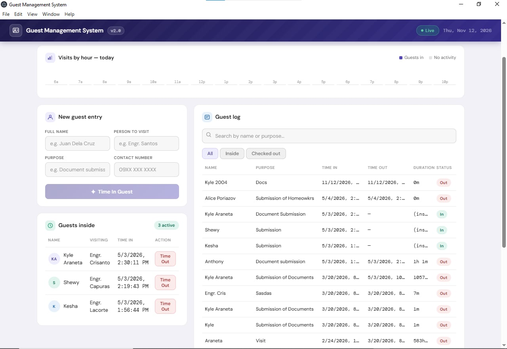
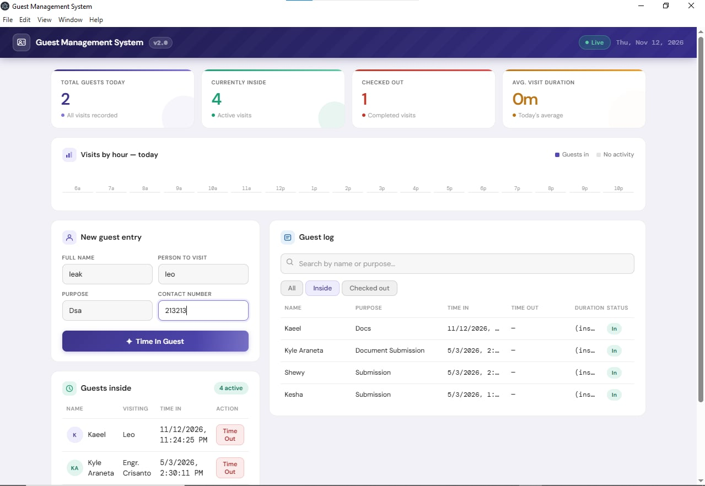
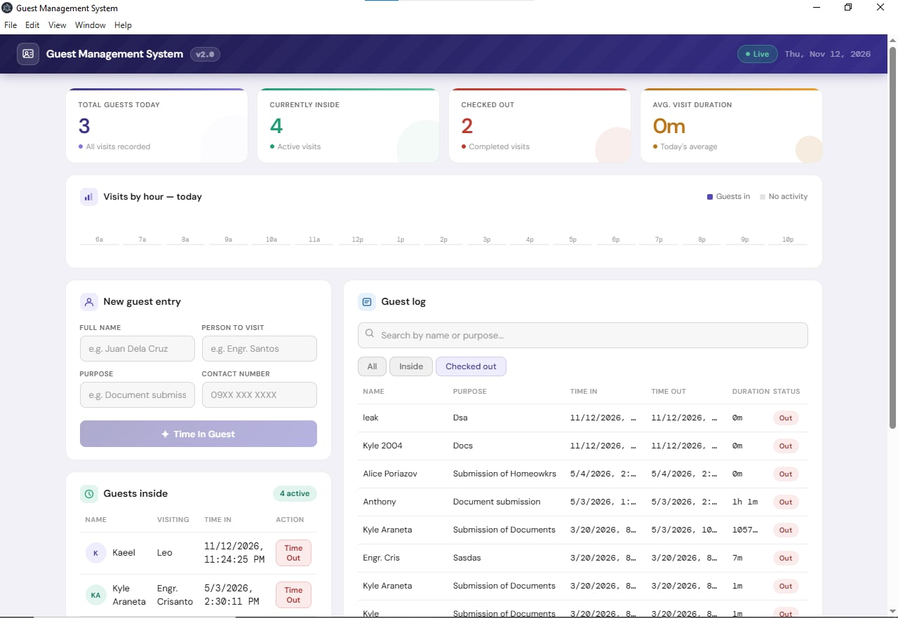
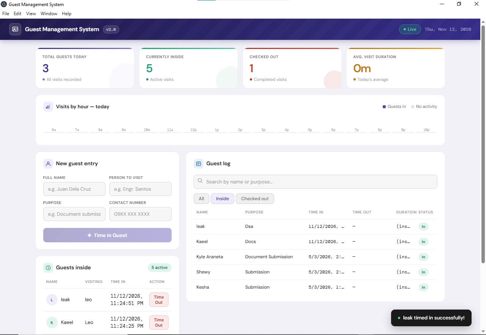
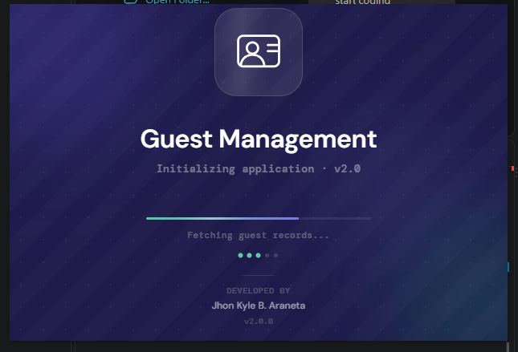
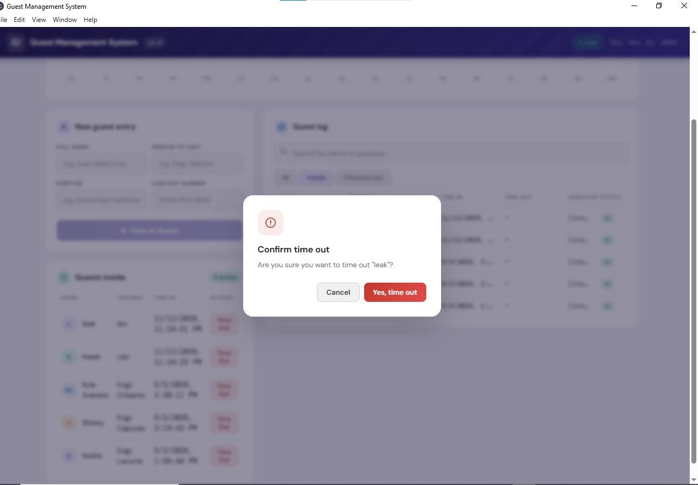
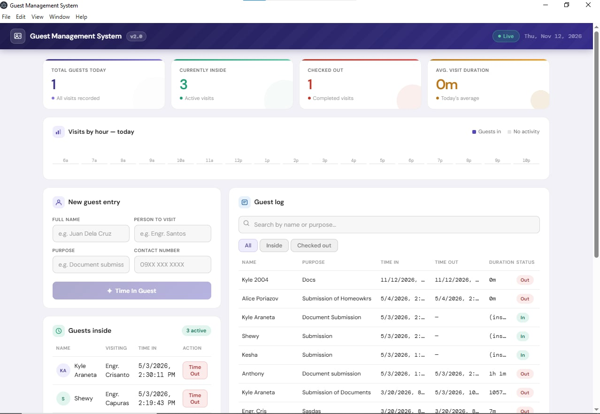

🏨 Guest Management System

A desktop-based Guest Management System designed to simplify guest registration, information management, and record organization.

📖 About the Project

The Guest Management System is an application designed to help manage and organize guest information efficiently. It provides a centralized platform where users can record, view, update, search, and manage guest records.

The system aims to minimize manual paperwork, improve record organization, and make guest information easier to access and maintain.

🎯 Objectives
To provide an organized platform for managing guest information.
To simplify guest registration and record management.
To reduce manual paperwork and human errors.
To make guest information easier to search and retrieve.
To improve the efficiency of guest management operations.
✨ Features
Guest Registration – Register and record guest information.
Guest Information Management – Manage and maintain guest records.
View Guest Records – Display registered guest information.
Update Guest Information – Modify existing guest details.
Search Guest Records – Easily find specific guest information.
Organized Guest Database – Store and organize guest records.
🛠️ Technologies Used
Frontend: HTML, CSS, JavaScript
Desktop Application Framework: Electron
Runtime Environment: Node.js
Database: SQLite
Code Editor: Visual Studio Code
Version Control: Git and GitHub

## 📸 System Screenshots

Below are screenshots showcasing the Guest Management System interface and its functionalities.

### 1. Application Interface

### 2. Guest Management Interface

### 3. System Features

### 4. Guest Records

### 5. Application Dashboard

### 6. System Interface

### 7. Additional System View

💻 Installation

Follow these steps to run the project on your local computer.

Prerequisites
Node.js installed
npm (Node Package Manager)
Git
Installation Steps

1. Clone the repository

bash
git clone https://github.com/KyleAraneta/guestmanagementsystem.git

2. Navigate to the project directory

bash
cd guestmanagementsystem

3. Install the project dependencies

bash
npm install

4. Start the application

Run the start script defined in your package.json.

bash
npm start

👨‍💻 Project Developer

Kyle Araneta

GitHub: @KyleAraneta

📌 Project Information

This project was developed as a Guest Management System application to improve the organization, accessibility, and management of guest information.

⭐ If you find this project interesting, feel free to explore the repository!